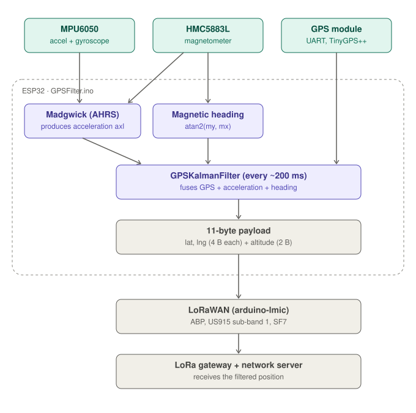
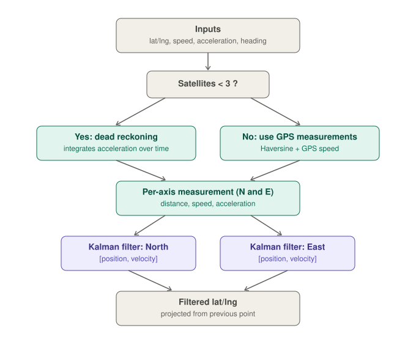
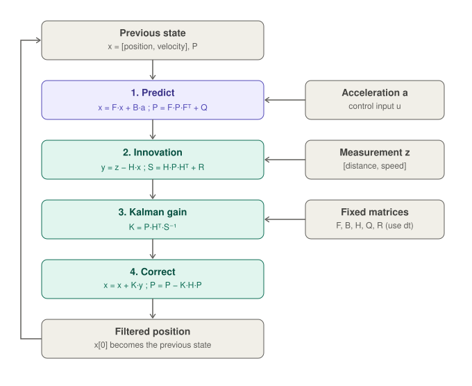
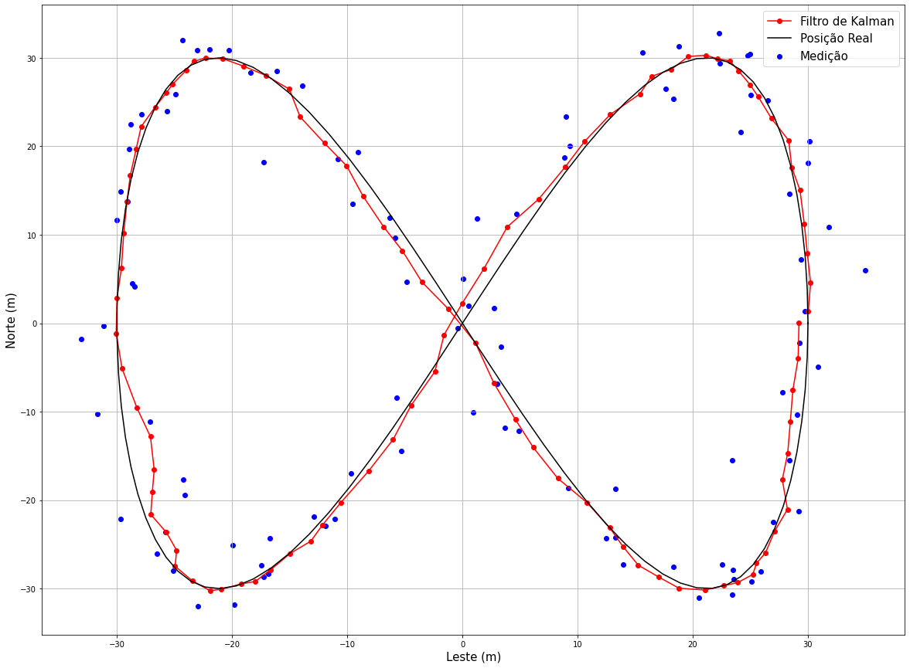

# GPS Tracking System

An embedded vehicle-tracking system that improves GPS position accuracy by fusing the GPS with an accelerometer, gyroscope and magnetometer through a **Kalman filter**, then sends the filtered position over **LoRaWAN**.

The project started as a university capstone to build an automotive tracking system for a **police car fleet in Espírito Santo, Brazil**. It runs on an **ESP32** (Arduino environment) and includes the firmware, the supporting libraries, calibration tools and simulation notebooks.

---

## Table of contents

- [How it works](#how-it-works)
- [The Kalman filter](#the-kalman-filter)
- [Hardware](#hardware)
- [Repository contents](#repository-contents)
- [Payload format](#payload-format)
- [Getting started](#getting-started)
- [Magnetometer calibration](#magnetometer-calibration)
- [Simulations and results](#simulations-and-results)
- [Known issues and limitations](#known-issues-and-limitations)
- [Credits and licenses](#credits-and-licenses)

---

## How it works

Three sensors feed the ESP32. The firmware estimates the device's orientation, computes a heading, and runs the Kalman filter on the GPS position. The result is packed into a small binary payload and transmitted over LoRa.



Step by step (`GPSFilter.ino`):

1. **Read the sensors.** The MPU6050 (accelerometer and gyroscope) and the HMC5883L (magnetometer) are read over I²C. The GPS sends NMEA data over a serial port, parsed by TinyGPS++.
2. **Estimate orientation.** The Madgwick AHRS algorithm fuses accelerometer, gyroscope and magnetometer into a quaternion. From it the firmware obtains yaw, pitch and roll and the **linear acceleration** (`axl`, the accelerometer reading minus the gravity component).
3. **Compute heading.** The heading comes from the calibrated magnetometer: `atan2(m_y, m_x)`.
4. **Filter the position.** About every 200 ms the firmware calls `gpsKalmanFilter.filterCalculation(...)` with the previous and current GPS coordinates, speed, acceleration, number of satellites and heading. It returns the filtered latitude and longitude.
5. **Build the payload.** Latitude, longitude and altitude are packed into 10 bytes.
6. **Transmit.** The payload is sent through `arduino-lmic` (LoRaWAN, ABP activation). See the [known issues](#known-issues-and-limitations): the transmission code in `loop()` is currently commented out.

---

## The Kalman filter

`GPSKalmanFilter` runs **two independent 2-state filters**, one for the North axis and one for the East axis. Each state is `[position, velocity]`.



Key ideas:

- **Fewer than 3 satellites:** the GPS is considered unreliable, so the filter falls back to *dead reckoning*, integrating the acceleration (split into North/East using the heading) to estimate velocity and displacement.
- **3 or more satellites:** the filter uses the Haversine distance between the previous and current GPS fixes, and the GPS speed, as measurements.
- **Output:** the filtered displacement is projected from the previous point on the sphere (earth radius 6,378,140 m) to give the filtered latitude and longitude.

Inside each axis, the filter runs the standard predict / update cycle:



Model and parameters used in the code:

| Item | Value |
| --- | --- |
| Time step `dt` | 0.20 s (must match the real loop period) |
| State transition `F` | `[[1, dt], [0, 1]]` |
| Control matrix `B` | `[dt²/2, dt]` (acceleration as control input) |
| Measurement matrix `H` | identity (2×2) |
| Sensor noise `R` | `diag(6.25, 5)` |
| Process noise `Q` | built from `Q_var = 0.1` and powers of `dt` |
| Initial covariance `P` | `diag(5, 1)` |

---


## Hardware

| Component | Role | Interface |
| --- | --- | --- |
| ESP32 board (a LILYGO LoRa board is referenced in the code comments) | Main microcontroller | n/a |
| GPS module | Position, speed, altitude, satellite count | UART at 9600 baud (RX on GPIO 34, TX on GPIO 12) |
| MPU6050 | 3-axis accelerometer + 3-axis gyroscope | I²C |
| HMC5883L | 3-axis magnetometer | I²C (address `0x1E`) |
| LoRa radio (SX1276) | LoRaWAN uplink | SPI (NSS 18, RST 23, DIO 26/33/32) |

---

## Repository contents

| Path | Description |
| --- | --- |
| `GPSFilter.ino` | Main firmware: sensor reading, Madgwick fusion, Kalman filtering, payload creation and LoRa configuration. |
| `GPSKalmanFilter/` | The Kalman filter library written for this project. In this snapshot the folder is empty; the library lives in its own repository: [gabrielbklopes/GPSKalmanFilter](https://github.com/gabrielbklopes/GPSKalmanFilter). |
| `Haversine/` | Distance and bearing calculations between two points on the globe. |
| `MPU6050/` | Driver for the accelerometer/gyroscope (modified for this project). |
| `HMC5883L/` | Driver for the magnetometer (modified for this project). |
| `arduino-lmic-master/` | LoRaWAN stack (third-party, MCCI/IBM LMIC), adapted for the ESP32. |
| `calibration_mag.ino` | Sketch that finds the magnetometer offsets and scale factors. |
| `KFSimulationGPS.ipynb` | Google Colab notebook applying the Kalman filter to data collected from the embedded system. |
| `PathSimulationKF.ipynb` | Simulates a car path with trigonometric position, velocity and acceleration. A good starting point to understand the filter. |

---

## Payload format

Each uplink is an 11-byte buffer, of which 10 bytes are used (big-endian, `FPort 1`):

| Bytes | Content | Encoding |
| --- | --- | --- |
| 0 to 3 | Latitude | degrees × 1,000,000 |
| 4 to 7 | Longitude | degrees × 1,000,000 |
| 8 to 9 | Altitude | meters × 100 |
| 10 | Unused | reserved |

The packing code only updates the stored coordinates when the filtered latitude is non-zero, so the last valid position is re-sent when there is no fix.

Example decoder for a LoRaWAN network server (JavaScript):

```javascript
function decodeUplink(input) {
  const b = input.bytes;
  const lat = ((b[0] << 24) | (b[1] << 16) | (b[2] << 8) | b[3]) / 1e6;
  const lon = ((b[4] << 24) | (b[5] << 16) | (b[6] << 8) | b[7]) / 1e6;
  const alt = ((b[8] << 8) | b[9]) / 100;
  return { data: { latitude: lat, longitude: lon, altitude: alt } };
}
```

---

## Getting started

### Requirements

- Arduino IDE (or PlatformIO) with ESP32 board support
- Libraries: **TinyGPSPlus**, **Wire**, **SPI**
- The local libraries in this repository: `Haversine`, `MPU6050`, `HMC5883L`, `arduino-lmic-master` and `GPSKalmanFilter` (from its own repository). Copy each folder into your Arduino `libraries/` directory.

### Steps

1. Wire the GPS, MPU6050, HMC5883L and LoRa radio to the ESP32 using the pins above (adjust `lmic_pins` and the GPS pins in `GPSFilter.ino` if your board differs).
2. In `arduino-lmic-master/project_config/lmic_project_config.h`, select the correct LoRa region (the file in this repository enables `CFG_us915`) and the radio type (`CFG_sx1276_radio`).
3. In `GPSFilter.ino`, set your own `NWKSKEY`, `APPSKEY` and `DEVADDR` (ABP activation) for your network server.
4. [Calibrate the magnetometer](#magnetometer-calibration) and update the offsets in `loop()`.
5. To enable transmission, uncomment the LoRa block at the start of `loop()` (`os_runloop_once()` and the `do_send()` timer).
6. Upload the sketch and open the serial monitor at **115200 baud**.

On boot, the sketch checks the MPU6050 (`WHO_AM_I` must return `0x68`), runs its self-test and calibrates gyroscope and accelerometer biases, so keep the device still during startup.

---

## Magnetometer calibration

Cars cause strong electromagnetic interference, so the magnetometer must be calibrated against hard-iron and soft-iron effects.

1. Upload `calibration_mag.ino`.
2. Rotate the device slowly through all orientations while it is installed in the vehicle.
3. Read the computed offsets (`offX`, `offY`, `offZ`) and scale factors from the serial monitor.
4. Put them in the calibration lines of `loop()` in `GPSFilter.ino`, which currently use fixed values:

   ```cpp
   m_x = (((float)mag.XAxis * 0.92f) - 175)  * 1.29;
   m_y = (((float)mag.YAxis * 0.92f) - 29.5) * 0.85;
   m_z = (((float)mag.ZAxis * 0.92f) - 21)   * 0.95;
   ```

These values are specific to one device and installation. Recalibrate for yours.

---

## Embedded and Simulation results

The image bellow shows the results for the filter considering the mathematical calculation of the bearing angle. 


Using the bearing angle provided by the magnetometer an error occours due to the electromagnetic interference from the car.


- `PathSimulationKF.ipynb` builds a synthetic path so you can see how position, velocity and acceleration relate and how the filter reacts.
- `KFSimulationGPS.ipynb` replays data recorded by the embedded system and plots filtered versus raw positions.


.png)
.png)
.png)


---

## Known issues and limitations

- **LoRa is disabled in `loop()`.** The `os_runloop_once()` block is commented out, so the current sketch filters and builds the payload but does not transmit until you uncomment it.
- **Heading source.** The magnetometer heading is affected by vehicle interference. The Madgwick yaw is computed but the raw magnetometer heading is what is passed to the filter.
- **Secrets in source code.** The LoRaWAN session keys and device address are hard-coded in `GPSFilter.ino`. Replace them with your own and avoid committing real keys; if you published real keys, rotate them.
- **Code style.** The author notes the code does not follow best practices: manual matrix loops, a long `loop()` mixing several responsibilities, and leftover commented-out debug code.

---

## Credits and licenses

- **Author:** Gabriel Lopes, capstone project for the police vehicle fleet of Espírito Santo, Brazil.
- **`arduino-lmic`:** third-party library from IBM, Thomas Telkamp, Matthijs Kooijman and MCCI, under the MIT license (see `arduino-lmic-master/LICENSE`).
- **`HMC5883L` and `calibration_mag.ino`:** based on the work of Korneliusz Jarzebski.
- **`Haversine`:** based on code by Matheau Goonan, modified for this project.
- **Madgwick Filter:** based in the work of Kris Winer.
- **MPU6050 driver:** modified for this project;
